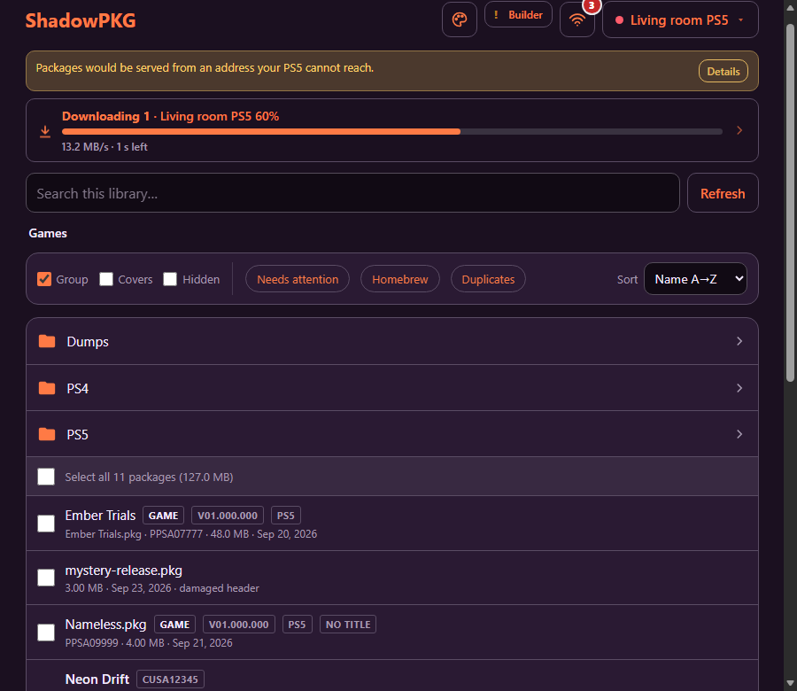
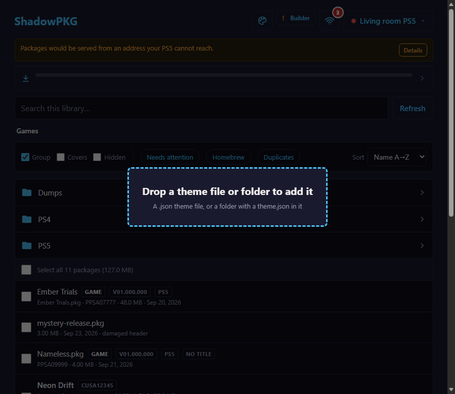
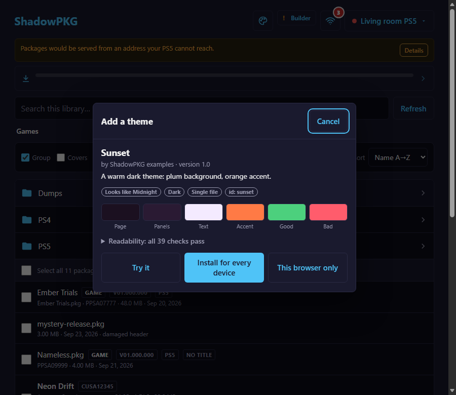
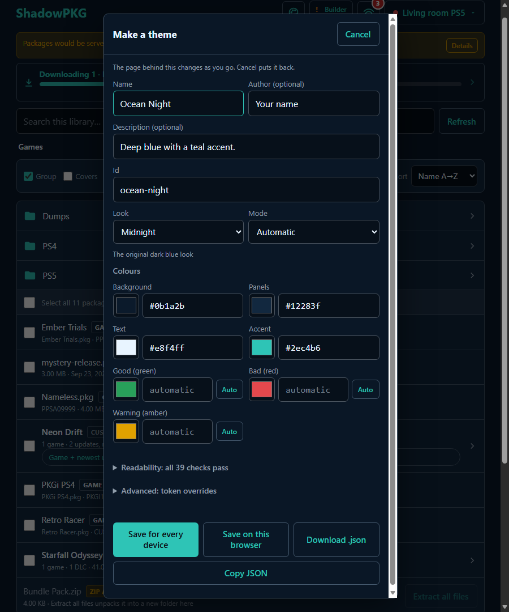
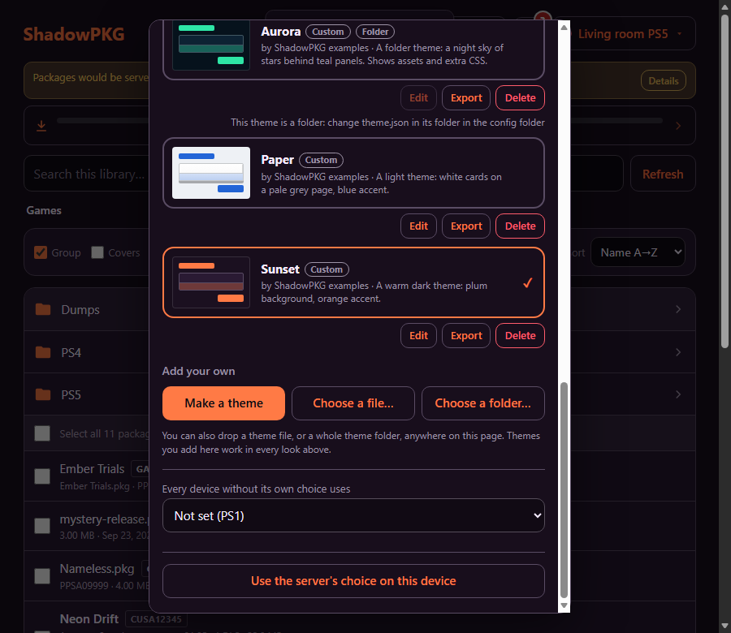

# Making your own ShadowPKG theme

This guide is for people. It takes you from "I want ShadowPKG to look different" to a theme that works, step by step. You do not need to know JSON or CSS to start. You only need a browser.

**Are you an AI assistant?** Read [THEMES-FOR-AGENTS.md](THEMES-FOR-AGENTS.md) instead. It has the same facts in the shape a program needs. If a person asked you to make a theme, that file is your guide. If you are a person, keep reading. You can also hand that file to your assistant later ([section 9](#9-using-an-ai-assistant-to-make-one)).

**Contents**

1. [What a theme is](#1-what-a-theme-is)
2. [Try the examples in two minutes](#2-try-the-examples-in-two-minutes)
3. [Make your own without typing code](#3-make-your-own-without-typing-code)
4. [Edit a theme file by hand](#4-edit-a-theme-file-by-hand): the smallest file, a fuller file, and a colour cheat sheet
5. [Installing in all the ways](#5-installing-in-all-the-ways): drag and drop, choosing a file, the config folder, scripts
6. [Picking what everyone sees](#6-picking-what-everyone-sees)
7. [Pictures, fonts and extra style](#7-pictures-fonts-and-extra-style)
8. [If something goes wrong](#8-if-something-goes-wrong): every message, and "my theme looks wrong"
9. [Using an AI assistant to make one](#9-using-an-ai-assistant-to-make-one)
10. [Reference](#10-reference): fields, every colour setting, value forms, limits, the base looks, the API

The screenshots use the Midnight look for the windows, so they are easy to read. A brand-new install looks like **NES** instead (boxy two-tone grey, a black-and-red badge, square corners), and your library may be empty (*This folder is empty.*), so you will see the colours change on the header, search box and toolbar rather than on a list of packages. The words on the buttons are the same.

---

## 1. What a theme is

- A theme changes how ShadowPKG looks: colours, the page background, corner rounding, the typeface, and (if you want) a few extra style rules and pictures.
- It is **data**, not a program. It is one small text file, or one small folder. It cannot add buttons, move things around, or run anything.
- You give it **four colours** (page, panels, text, accent). ShadowPKG works out the other forty-odd colours from them and keeps the text readable.
- Every theme is built on one of the fourteen built-in looks, which decide the shapes (flat, glossy, pixel-art bevels and so on). The app calls them **Look**; the files call them `base`.
- Install a theme **for every device** and every phone, tablet and PC that opens ShadowPKG can pick it.



*The example theme "Sunset" on the main list.*

Three words you will meet, explained once:

- **Manifest**: the theme's settings file. A single-file theme *is* its manifest. A folder theme keeps it in `theme.json`.
- **Palette**: the colours you choose in the manifest.
- **Token**: one named setting that a theme can change, such as `--radius` (how round corners are). There are 48. You only need them when the four colours are not enough.

---

## 2. Try the examples in two minutes

The examples are in the `examples/themes/` folder of the ShadowPKG download, the same download that holds this guide: `sunset.json`, `paper.json`, and a folder called `aurora`. Copy them to the computer whose browser you use. If ShadowPKG runs on a server such as Unraid, the examples are not on the server: they are in the ShadowPKG download from GitHub (**Code**, then **Download ZIP**). Unzip it on the PC you browse from and open `examples/themes/`.

1. Open ShadowPKG in your browser. The first time, a window called **Setup and network** opens. Its red ✕ lines are about connecting a PS5 and have nothing to do with themes. Press **Done** to close it.
2. Drag `sunset.json` from your file manager onto the page. The page dims and a box says **Drop a theme file or folder to add it**. Let go.

   

3. A window called **Add a theme** opens. You should see the name *Sunset*, small tags (*Looks like Midnight*, *Dark*, *Single file*, *id: sunset*), six colour squares, and the line **Readability: all 47 checks pass**.

   

4. Press **Try it**. The window closes and the whole page turns plum and orange (with an empty library, only the header, search box and toolbar show it). A small bar at the top of the page says **Trying Sunset** with two buttons, **Keep** and **Undo**. Nothing is saved yet. **Undo** puts everything back and forgets the file.
5. Press **Keep**. The **Add a theme** window comes back. (Keep does not save by itself. It brings the window back so you can say where to save.)
6. Press **Install for every device**. A green note flashes at the top for a few seconds: *Installed Sunset for every device.* This browser now uses Sunset.
7. Open the palette icon at the top right of the page (its tooltip is **Theme**). The fourteen built-in looks come first, so scroll down inside the window: Sunset is after them, with a **Custom** tag and a tick. Press **Done** (top right of the window) to close it.
8. Now drag `paper.json` the same way (a light theme). This time you can press **This browser only** instead: you see *Kept Paper on this browser.* and the list adds a **This browser only** tag next to **Custom**. Only this browser has it (not your phone, and clearing the browser's data loses it). Then drag the `aurora` folder. **Drag the folder itself, not the files inside it.** Aurora has a picture of stars behind the page. **Try it** shows a folder theme's colours but not its pictures; they appear once you press **Install for every device**.
9. To switch, open **Theme** and click a theme's card anywhere: a built-in look such as **PS1**, or one of yours. Your themes stay installed. Under each of your own themes are **Edit**, **Export** and **Delete**. **Delete** asks you to confirm first (*Delete "Sunset" for every device?*, or *Remove "Paper" from this browser?*).

If nothing happened, or a window said **That did not work as a theme**, go to [section 8](#8-if-something-goes-wrong).

---

## 3. Make your own without typing code

Open **Theme** (the palette icon) and scroll to the bottom of the window: **Make a theme** is under **Add your own**, after the built-in looks and any themes of yours. (**Done** closes the Theme window.) The page behind the window changes as you go, so you see the real result on the real lists and buttons. **Cancel** (top right of the window) puts everything back.



Every control, by its label:

| Label | What it does |
|---|---|
| **Name** | What the Theme window will show. Required, up to 40 characters, no `<` or `>`. |
| **Author (optional)**, **Description (optional)** | Shown under the name. Up to 40 and 140 characters. |
| **Id** | Made from the name for you: lower-case letters, digits and dashes. It becomes the file name. You can change it until you save; after that it is fixed. It cannot be the id of a built-in look. |
| **Look** | Which of the fourteen built-in looks to build on. A line under the box describes the one you picked. **Midnight** is the plain, flat one and a good first choice. |
| **Mode** | **Automatic** (dark or light is worked out from your background colour), **Dark**, or **Light**. Leave it on Automatic unless the result looks wrong. |
| **Background** | The page behind everything. |
| **Panels** | The lists, toolbar, cards and menus that sit on the page. |
| **Text** | The main text colour. |
| **Accent** | Main buttons, selected rows, the progress bar, checkbox ticks, and (unless you say otherwise) links and the title. |
| **Good (green)**, **Bad (red)**, **Warning (amber)** | Optional. They show "automatic" until you pick one; the **Auto** button next to each puts it back to automatic. |
| **Readability** (a line you can open) | The list of text-on-background checks. See [section 8](#82-my-theme-looks-wrong). |
| **Advanced: token overrides** | For experts: a box for settings like `{"--radius": "10px"}`. The server checks them, and an error shows under the box. You can ignore it. |

Each colour has a colour square (click it to pick) and a box for the hex code (`#0b1a2b`; `#rgb` short codes work too). A hex code is the way computers write a colour; the colour square gives you one without any typing.

Under the colours a note may appear, such as *The text colour was adjusted to #82a9d4 to keep it readable.* That means your text was too close to the page or panel colour, so ShadowPKG showed a different one. The theme still works, and the file keeps the colour you typed, but the page shows the adjusted one. To fix it, type a much lighter (or, for a light theme, darker) colour into **Text**, for a dark theme try `#e8f4ff`. **Readability** may still say *all 47 checks pass*, because the adjustment is what makes it pass. See the [cheat sheet](#44-a-colour-cheat-sheet).

**Saving and sharing.** The four buttons at the bottom:

| Button | What happens |
|---|---|
| **Save for every device** | Installs it on the server (a file in the config folder's `themes` folder) and switches this browser to it. The maker closes, the page changes, and a green note *Saved Ocean Night for every device.* flashes at the top for a few seconds. |
| **Save on this browser** | Keeps it only in this browser. Nobody else sees it. (Greyed out when you edit a theme that is already on the server.) |
| **Download .json** | Saves `<id>.json` into your Downloads folder, and a line at the bottom of the window says *Saved <id>.json.* Your browser may show a download bar too. That is a file on your PC, which is not the same as saving for every device. It is the file to share, keep, or edit by hand. Press it before you save; after saving the maker is closed, and you would reopen it with **Edit**. |
| **Copy JSON** | Puts the same text on the clipboard: *Copied. Paste it into a file called <id>.json, or into a chat.* If your browser refuses (*Your browser would not let the page copy*), use **Download .json**. |

If you save under an id that is already installed for every device, the page asks *A theme with the id "sunset" is already installed for every device. Replace it?* before it writes anything. If something is missing you get a plain message, such as *Give the theme a name first.* or *"midnight" is the name of a built-in theme; pick another id.*

**Changing a theme later.** In the Theme window, press **Edit** on it. That reopens the maker with your choices; anything the maker has no box for (extra style, fonts) is kept. A **folder** theme cannot be edited here: its **Edit** button is greyed out with the reason. Change its `theme.json` by hand instead ([section 7](#73-a-folder-theme)).

---

## 4. Edit a theme file by hand

### 4.1 The rules of the file, for people who have never written JSON

A theme file is JSON, a plain-text format made of `"name": value` lines inside curly braces.

- Use a plain-text editor (Notepad, TextEdit in plain-text mode, VS Code). Not Word.
- Use **straight** double quotes `"`. Curly quotes from a word processor break it.
- Put a **comma** after every line except the last one inside `{ }`.
- Save the file as UTF-8. In Notepad choose **UTF-8** in the *Encoding* box of the Save window (not *Unicode*, which is UTF-16 and is not read).
- The file name ends in `.json`. On Windows, "hide extensions" can hide that you saved `sunset.json.txt`. Turn on **File name extensions** in File Explorer's View menu to check. The same goes for `theme.css`: make sure it is not `theme.css.txt`.
- If it goes wrong, the message tells you where ([section 8](#81-messages-and-what-to-do)).

### 4.2 The smallest valid file

```json
{
  "shadowtheme": 1,
  "name": "Sunset",
  "palette": {
    "background": "#1b1020",
    "surface": "#2a1a33",
    "text": "#f4eaff",
    "accent": "#ff7a45"
  }
}
```

Save it as `sunset.json`, drop it on the page, and it works. What each part means:

- `"shadowtheme": 1` says "this is a ShadowPKG theme, format 1". It is always `1`.
- `"name"` is what the Theme window shows.
- `"palette"` holds your colours. `surface` is what the maker calls **Panels**.
- There is no `"id"`, so the theme is named after the **file** when you drop or place it (`sunset.json` becomes `sunset`; `My Cool Theme.json` becomes `my-cool-theme`), not after `"name"`.
- There is no `"base"`, so it uses the flat Midnight look.

Only three things are required: `"shadowtheme": 1`, a `"name"`, and at least one of `palette`, `tokens` or `css`. The four colours are not required, but leave one out and it comes from the base look's own colours, which may surprise you. Write all four.

### 4.3 A fuller file

```json
{
  "shadowtheme": 1,
  "id": "sunset",
  "name": "Sunset",
  "author": "Someone",
  "description": "A warm dark theme: plum background, orange accent.",
  "version": "1.0",
  "base": "midnight",
  "mode": "dark",
  "palette": {
    "background": "#1b1020",
    "surface": "#2a1a33",
    "text": "#f4eaff",
    "accent": "#ff7a45",
    "good": "#4cd07d",
    "bad": "#ff5c6c",
    "warn": "#ffcf6a"
  },
  "tokens": {
    "--radius": "10px",
    "--radius-lg": "14px"
  }
}
```

This is `examples/themes/sunset.json` with a few lines changed. New here: `id` (the theme's short name: 1 to 32 lower-case letters, digits and dashes), `author`, `description`, `version` (shown, never compared), `base` (the look), `mode` (`"dark"` or `"light"`; leave it out to have it worked out), and `tokens` (single settings that replace what was worked out; here, rounder corners). Every field is listed in the [reference](#101-the-manifest-field-by-field).

Anything in the file that ShadowPKG does not know is ignored with a warning, so a theme written for a later version still loads.

### 4.4 A colour cheat sheet

You choose four colours. They do these jobs:

| Colour | Job | The maker calls it |
|---|---|---|
| `background` | The page behind everything. | **Background** |
| `surface` | The panels that sit on it: the file list, the toolbar, cards, menus. | **Panels** |
| `text` | Ordinary text, on the page and on the panels. | **Text** |
| `accent` | Main buttons, the progress bar, selected rows, checkbox ticks, folder icons, the keyboard outline. Also links and the title, unless you set `link`. | **Accent** |

Three more, all optional, all worked out for you: `good` (success text and the green dot; default green `#28a05a`), `bad` (errors and Delete buttons; default red `#e5484d`), `warn` (cautions; default amber `#e0a100`). Leave them out unless you want your own.

**What is worked out for you, in plain words.** ShadowPKG builds every other colour from these, then nudges any text colour that would be hard to read:

- **Dialogs** (the pop-up windows) use the page colour, moved 12% toward black on a dark theme or toward white on a light one. Set `"dialog"` to choose your own.
- **The bar at the bottom** (it appears when you tick packages) uses the page colour moved 22% toward black or white. Set `"tray"` to choose your own.
- **Links, the title and the library menu** use your `"link"` colour, or your accent if you gave none.
- **A selected row** is the panel colour mixed with your accent (a bit under a third accent), then adjusted so its text reads.
- **Quiet text** (hints, file details) is your text colour faded 40% toward the background.
- `"surface2"` is accepted but does nothing. Leave it out.

**How to choose.** Squint at the page. If you can still tell where the page ends and the panels begin, and you can still read the text, you are close.

| Colour | On a dark theme | On a light theme |
|---|---|---|
| Background | Very dark (`#0b1a2b`). | Very light (`#eef1f5`). |
| Panels | A small step lighter than the page (`#12283f`). | White, or a small step lighter than the page. |
| Text | Nearly white (`#e8f4ff`). | Nearly black (`#1d2733`). |
| Accent | Bright and colourful (`#2ec4b6`). | Deep and saturated (`#2a5fc9`). |

**Good and bad examples** (each one tried in the maker):

- **Text too close to the panel or page.** Background `#0b1a2b` with text `#14263a`. ShadowPKG rescues it: it pushes the text to `#82a9d4`, a mid blue-grey, and says so. It is readable, but it is not the colour you asked for. Pick text that is *very* different in brightness from the page, for example `#e8f4ff` on this one.
- **Background in the middle of the brightness range.** `#777777` is neither dark nor light, so no text colour reads well on it. ShadowPKG moved it to `#565656` and made the text nearly white. Pick a clearly dark or clearly light background.
- **Accent the same as the background.** Accent `#0b1a2b` on background `#0b1a2b`. Nothing is moved and no note appears, but the main buttons (like **Send**) become plain white words with no button shape, and selected rows barely stand out. Pick an accent that stands out from the page.
- **Panels the same as the background.** Both `#0b1a2b`. The panels have no fill of their own; only thin lines show where a list starts. Give the panels a visible step from the page.
- **A pale text on a pale page.** A light theme with background `#eef1f5` and text `#c9d0da`: the text is pushed to `#445164`. Again readable, but not what you picked.

The rescue only lasts while you use the four colours. If you set individual settings in `tokens`, they are used as given; see [section 8.2](#82-my-theme-looks-wrong).

---

## 5. Installing in all the ways

They all end in the same place: the theme is either **for every device** (saved on the server) or **this browser only**.

### 5.1 Drag and drop

Drag a theme from your file manager onto any ShadowPKG page. A box says **Drop a theme file or folder to add it**. It works even while a window is open.

- One `.json` file is a single-file theme.
- A folder that holds `theme.json` is a folder theme. **Drop the folder itself**, not what is inside it.
- Several loose files work too, if one of them is `theme.json`: `theme.css` is used as its extra style and the rest are its pictures and fonts. Two loose `.json` files together are refused.
- If the file has no `"id"`, the id comes from the **file name** (or the folder name).

The **Add a theme** window then shows the theme's name, author, description and a row of tags: *Looks like …*, *Dark* or *Light*, *Single file* or *Folder*, and *id: …*. Below are six colour squares (Page, Panels, Text, Accent, Good, Bad), the **Readability** line, and any warnings. The buttons:

| Button | What it does |
|---|---|
| **Try it** | Shows the whole page in the theme for now. A bar at the top says *Trying …*, with **Keep** and **Undo**. **Undo** puts everything back. **Keep** returns to this window so you can install. Nothing is saved by trying. |
| **Install for every device** | Saves it on the server. Every device that opens ShadowPKG then lists it, and this browser switches to it. Greyed out if the server cannot save (see below). |
| **This browser only** | Keeps it in this browser and nowhere else. Greyed out for a folder theme: a theme with its own files has to be on the server. |
| **Cancel** (top right) | Drops it. The page goes back to how it was. |

**A warning about styling.** Both this window and the Theme window carry a short notice: a theme's extra styling can change how anything on the page looks, and if a theme ever makes the page hard to use, open the page with `?safe=1` (see [8.3](#83-safe-mode)). A theme that carries css also shows *This theme has N styling rules of its own* and a **Show the styling rules** link that opens the rules as text, so you can read them before you install.

If a theme with that id is already installed, the window says so, and after you press **Install for every device** it asks *A theme with the id "sunset" is already installed for every device. Replace it with this one?* with **Replace it** and **Keep the old one**. If this browser already keeps one, **This browser only** asks the same. If the server has the id, **This browser only** will not replace it and tells you to install for every device or change the id.

If the server cannot save (its config folder is missing or read-only), **Install for every device** is greyed out and the window says *The server's settings folder is read-only, so it can only be kept on this browser.* The usual cause is a container started without the `/config` folder mapped; see [section 5.3](#53-by-hand-into-the-config-folder).


### 5.2 Choose a file or a folder

Open **Theme**. Under **Add your own** are **Make a theme**, **Choose a file…** and **Choose a folder…**. The last two do exactly what a drop does, for browsers and devices where dragging is awkward. **Choose a file…** lets you pick more than one file (theme.json with its pictures). Some phone browsers have no folder picker.



The list also has these buttons on each custom theme: **Edit** (opens the maker), **Export** (downloads `<id>.json`; for a folder theme, only its `theme.json`), and **Delete** (it asks first: *Delete "…" for every device? Devices using it go back to the server's choice.*, or *Remove "…" from this browser?*).

### 5.3 By hand, into the config folder

The server keeps installed themes in a folder called **`themes`** inside its **config folder**. You can put files there yourself.

**Where the config folder is:**

| How you run ShadowPKG | The config folder | Put themes in |
|---|---|---|
| **Unraid** (the template) | The **Config** path of the container. The default is `/mnt/user/appdata/ShadowPKG` in `shadowpkg.xml` and `/mnt/user/appdata/ShadowPKG_exp` in `shadowpkg-exp.xml`. Check under Docker, the ShadowPKG icon, **Edit**, the row named **Config** (container path `/config`). | `/mnt/user/appdata/ShadowPKG/themes/` |
| **Docker** with a bind mount | The host folder you mapped to `/config`, for example `-v /path/to/appdata/ShadowPKG:/config`. | `/path/to/appdata/ShadowPKG/themes/` |
| **Plain node** | Whatever the `CONFIG_DIR` environment variable says. If you set none, it is `/config` (`C:config` on Windows), which may be a place you did not intend, so set `CONFIG_DIR` (below). | `<your config folder>/themes/` |

For plain node (you need Node 18 or newer), open a terminal in the folder that holds `server.js`, make the folder, then start the server with `CONFIG_DIR` set. On macOS, Linux and Git Bash:

```
mkdir config
CONFIG_DIR=./config node server.js
```

On Windows PowerShell:

```
mkdir config
$env:CONFIG_DIR = ".\config"
node server.js
```

ShadowPKG creates the config folder if it can. Where the folder cannot be created or written (usually a container without `/config` mapped), **Install for every device** stays greyed out.

**The steps:**

1. Open the config folder. If it has no `themes` folder yet, make one (the name is `themes`, all lower-case). ShadowPKG makes it itself the first time you install from the page.
2. Copy a theme in. A single-file theme goes in as a file: `themes/sunset.json`. A folder theme goes in as a folder: `themes/aurora/theme.json`, `themes/aurora/theme.css` (optional) and `themes/aurora/assets/stars.svg`.
3. Reload the page. Nothing needs restarting: the server looks at the folder again, at most once a second.
4. Open **Theme**, scroll down to your theme (it has a **Custom** tag) and click it. Reloading only offers it; it does not switch to it.

```
themes/
  sunset.json            a single-file theme
  aurora/                a folder theme
    theme.json
    theme.css            optional
    assets/
      stars.svg
```

The id is the `"id"` in the file, or, if there is none, the file name without `.json` (or the folder name). Other files in the folder are left alone, and names that start with a dot are skipped.

**A file that does not work is not offered, and says why.** The Theme window shows a box at the bottom: *N theme files were not used:* with a line for each, like `broken.json - is not valid JSON`. The reasons you may see: *is not valid JSON*, *is not valid UTF-8 text* (save the file as UTF-8, not "Unicode"), *has no theme.json* (a folder without one), *its id "paper" is already used by paper-copy.json* (two files with the same id: the one whose name sorts first wins), *is larger than 1 MiB*, or one of the checks in [section 8.1](#81-messages-and-what-to-do). The same lines go to the server log (`docker logs ShadowPKG` on Docker, the container's **Logs** on Unraid) and to `server.log` in the config folder, starting with `themes:`. For example: `themes: 3 installed (aurora, paper, sunset)`.

To remove a theme, delete its file or folder. A device that had picked it goes back to the server's choice, or to NES.

### 5.4 From a script

Everything the page does, a script can do. See [the API](#107-the-api). A short version that installs a file:

```
curl -X POST http://SERVER-IP:12801/api/themes -H "Content-Type: application/json" -d "{\"theme\": $(cat sunset.json), \"replace\": true}"
```

That form is for a Unix-style shell (macOS, Linux, Git Bash). On Windows PowerShell:

```
Invoke-RestMethod -Method Post -Uri http://SERVER-IP:12801/api/themes -ContentType 'application/json' -Body ('{"theme":' + (Get-Content .\sunset.json -Raw) + ',"replace":true}')
```

### 5.5 Where a theme lives

| | **For every device** | **This browser only** |
|---|---|---|
| Kept | On the server, in the `themes` folder | In this browser's own storage |
| Seen by | Every device that opens the page | Only this browser on this device |
| Can be a folder theme | Yes | No |
| Survives clearing browser data | Yes | No |
| Room | 64 themes on the server | About 1 MB in all, for every such theme together. A theme with an embedded font or picture takes about twice its file size there, so keep those under about 450 KB or install them for every device. |

---

## 6. Picking what everyone sees

Two separate choices exist.

- **Each device picks its own.** Open **Theme** and press a look. The choice is remembered by that browser on that device. Installing a theme also picks it on the device you installed from.
- **The server's choice** is what a device shows **if it has not picked anything**. To set it: open **Theme**, scroll to the bottom (it is below the **Add your own** buttons), and open the drop-down under **Every device without its own choice uses**. Choose **Sunset**, for example. A note says *Devices without their own choice now use Sunset.* The drop-down lists **Not set (NES)**, the built-in looks, and the themes **Installed for every device**. It is saved in `settings.json` in the config folder. A device that has already picked keeps its own choice. To see it work, open ShadowPKG in a different browser (or a private window) that has never picked a theme: it opens in Sunset.

**Use the server's choice on this device** (a button at the bottom of the Theme window, shown only when this device has picked its own) forgets this device's pick and follows the server's choice again.

You can also set the server's choice before anyone opens the page, with the `DEFAULT_THEME` setting, for example `DEFAULT_THEME=sunset` (a built-in id such as `midnight` works too). On Docker add `-e DEFAULT_THEME=sunset`. On Unraid, open **Edit**, press **Show more settings** and fill in **Theme for devices that have not chosen one (DEFAULT_THEME)**. (A container made from an older template has no such row: use **Add another Path, Port, Variable, Label or Device**, type **Variable**, and give it the name and key `DEFAULT_THEME`.) The choice made in the Theme window beats it. The window then says *Set by the DEFAULT_THEME setting of the container. Choosing here overrides it.* A name that is not a built-in look or an installed theme is ignored, and the log says so once; the setting takes effect once that theme is installed.

If the server's choice is deleted, it is cleared. A device whose own pick was deleted falls back to the server's choice, or to NES.

The very first time a brand-new device opens the page, it may show the theme's base look for a moment before the theme's colours arrive. After that, the page paints the device's theme before it draws anything.

---

## 7. Pictures, fonts and extra style

Most themes need none of this. Read on if you want a background picture, your own typeface, or a touch that colours cannot reach.

### 7.1 Single file or folder?

| | **Single file** (`sunset.json`) | **Folder** (`aurora/`) |
|---|---|---|
| Pictures and fonts | Written into the file as text (a `data:` address) | Kept as ordinary files in `assets/` |
| Extra style | In the `"css"` line | In `theme.css` (or `"css"`, or both) |
| Size | Up to 1 MiB | Up to 4 MiB, 24 files, 1.5 MiB each |
| Best for | Sharing: one file to send | Real pictures and fonts |
| Edit in the maker | Yes | No: edit by hand |
| This browser only | Yes (if small: a theme with an embedded font or picture counts about twice, so about 450 KB is the practical limit) | No |

There is no zip format. A folder does the same job.

### 7.2 Turning a small picture into a `data:` address

A single-file theme cannot point at a picture file. Instead, the picture's bytes are written into the theme as text. The text starts with `data:image/png;base64,` and then a long string of letters and digits. That is called a **`data:` address**. The string is the picture written in Base64, a way to spell any file with ordinary characters.

Limits: the picture may be up to 300 KB. Base64 makes text a third bigger than the picture, and the whole theme must stay under 1 MiB, so this is for small textures and icons. Bigger pictures need a folder theme.

Allowed picture types and their labels: PNG `image/png`, JPEG `image/jpeg`, WebP `image/webp`, GIF `image/gif`, SVG `image/svg+xml`. The file must really be that type; a text file renamed to `.png` is refused.

**Windows** (PowerShell, which every Windows PC has). Change the path in the first line, then paste the result into your theme:

```
$file = "C:\Users\you\Pictures\dots.png"
"data:image/png;base64," + [Convert]::ToBase64String([IO.File]::ReadAllBytes($file)) | Set-Clipboard
```

The finished address is now on your clipboard. Press Ctrl+V in your text editor. For a JPEG write `image/jpeg` instead of `image/png`. To get it in a text file rather than on the clipboard, end with `| Out-File -Encoding ascii -NoNewline dots.txt` instead of `| Set-Clipboard`.

**macOS and Linux** (Terminal). This writes the finished address into `dots.txt`, which you open and copy from:

```
printf 'data:image/png;base64,%s' "$(base64 < dots.png | tr -d '\n')" > dots.txt
```

On a Mac you can end with `| pbcopy` instead of `> dots.txt` to put it on the clipboard; on Linux, `| xclip -selection clipboard` does the same if `xclip` is installed.

**Put it in the theme.** As the value of `--bg-image`, wrapped in `url( … )`. This whole file is valid. The picture is a 24-pixel tile with one faint dot, repeated across the page:

```json
{
  "shadowtheme": 1,
  "id": "dotty",
  "name": "Dotty",
  "base": "midnight",
  "palette": {
    "background": "#1b1020",
    "surface": "#2a1a33",
    "text": "#f4eaff",
    "accent": "#ff7a45"
  },
  "tokens": {
    "--bg-image": "url(data:image/png;base64,iVBORw0KGgoAAAANSUhEUgAAABgAAAAYCAYAAADgdz34AAAAN0lEQVR4nGP4//8/Ay0xTQ0ftWDUglELyLdAg5YWaCBhqluggQUPLR/QJQ5IxqMWjFowasF/BgBS2Luj/QIq+QAAAABJRU5ErkJggg==)"
  }
}
```

Tips: put the whole `url(...)` on one line inside the quotes. The 300-character limit on a value does not count the picture's own bytes, so a long `data:` string is fine. You can layer up to three pictures or gradients, separated by commas: `"url(data:...), linear-gradient(#061a26, #06121c)"`, the first on top.

A picture behind the page should be quiet. The readability check only knows the flat colours, not your picture, so bright shapes behind text can make it hard to read while the report still says everything passes. Look at the real page.

### 7.3 A folder theme

You need a real picture file (PNG, JPEG, WebP, GIF or SVG). Save one from a picture site, or draw a small one in Paint and choose Save as PNG. Small, quiet, tileable pictures work best (48 to 200 pixels).

Lay it out like this. It is the same layout as `examples/themes/aurora`:

```
aurora/
  theme.json        the manifest (required)
  theme.css         extra style (optional)
  assets/           pictures and fonts (optional, one level, no sub-folders)
    stars.svg
```

In `theme.json`, point at a picture as `assets/<file name>`, spelled exactly like the file (`dots.png` and `Dots.png` are different names):

```json
"tokens": {
  "--bg-image": "url(assets/stars.svg), radial-gradient(ellipse at 50% -10%, #061a26 0%, #06121c 70%)"
}
```

This is a complete minimal folder `theme.json`, all a folder theme needs (with no `id` line the folder's name is the id; if two folders show the same name in the window, the tag *id: …* tells them apart):

```json
{
  "shadowtheme": 1,
  "name": "Forest Night",
  "palette": { "background": "#0d1a12", "surface": "#16291d", "text": "#e8f5ec", "accent": "#3ecf6e" },
  "tokens": { "--bg-image": "url(assets/dots.png)" }
}
```

Rules for the `assets` files:

- Types: `png`, `jpg`, `jpeg`, `webp`, `gif`, `svg`, `woff`, `woff2`, `ttf`, `otf`.
- File names: letters, digits, dot, dash and underscore, starting with a letter or digit, up to 64 characters. No spaces. A file with another name is ignored, not used: the **Add a theme** window warns about it, and a folder you place by hand gives no warning at all. `my file.png` is ignored; `my-file.png` works.
- At most 24 files, each up to 1.5 MiB, 4 MiB in all. `theme.json` and `theme.css` count as files.
- The bytes must match the name (a real PNG in a `.png`).
- An SVG must be plain shapes. An SVG with a `<script>`, a `foreignObject`, an `on...=` event attribute, an `@import`, or a link to anywhere outside the file is refused.
- Nothing may come from the internet. `http://`, `https://`, `//host`, absolute paths and `..` are all refused, so a theme can never make your browser fetch something from elsewhere.

ShadowPKG serves each asset at `themes/<id>/assets/<file>` on your server. To **install** a folder, drop it on the page, choose it with **Choose a folder…**, or copy it into the config folder's `themes` folder ([5.3](#53-by-hand-into-the-config-folder)). To **change** an installed folder theme, edit its files in the `themes` folder; the server notices within a second.

### 7.4 Fonts

Declare each font under `"fonts"`, then use its name in the `--font` token. In a folder theme:

```json
{
  "fonts": [
    { "family": "My Font", "src": "assets/my-font.woff2", "weight": "400" },
    { "family": "My Font", "src": "assets/my-font-bold.woff2", "weight": "700" }
  ],
  "tokens": { "--font": "\"My Font\", system-ui, sans-serif" }
}
```

- `family` is the name you choose: letters, digits, spaces, dot, dash and underscore, starting with a letter, up to 40 characters. You cannot use `serif`, `sans-serif`, `monospace`, `cursive`, `fantasy`, `system-ui`, `inherit`, `initial`, `unset`, `default` or `pixelchrome` (in any capitals): the page already uses them.
- `src` is `assets/<file>` in a folder, or a `data:font/woff2;base64,…` address in a single file (`font/woff`, `font/ttf` and `font/otf` also work, up to 900 KB). Make the address the same way as for a picture in [7.2](#72-turning-a-small-picture-into-a-data-address), with `data:font/woff2;base64,` at the start.
- `weight` is `100`, `200`, … `900`, or `normal` or `bold`. If you leave it out it is `400`.
- Up to four fonts.
- In `--font`, a bare name may use only letters, digits, spaces, dash and underscore, and must start with a letter. A name with a dot or other marks **must be in quotes**: `"Roboto.Slab"` works, `Roboto.Slab` is refused. Use up to 8 names separated by commas, 200 characters in all, and end with a fallback such as `sans-serif`.
- The pixel-art looks (**PS1**, **PS1-V2**, **SNES**) still set their buttons, title and dialog headings in their own pixel font, whatever `--font` says.

Only put a font in a theme you share if you are allowed to hand it out.

### 7.5 Extra style (CSS)

CSS is the language web pages use for style. When colours and tokens cannot do what you want, a theme can add rules. In a single file they go in the `"css"` line (as one line of text). In a folder they go in `theme.css`; if both exist, they are joined.

The whole rule format is `selector { property: value; }`. A **selector** says what to style (`h1` is the page title); a property and value say how.

**Three recipes, all tried on the running page.** Each goes in `theme.css`, or in the `"css"` line of a single-file theme.

**1. A glowing, spaced-out title.**

```css
h1 { letter-spacing: 2px; text-shadow: 0 0 14px rgba(255, 122, 69, 0.6); }
```

Change the colour to suit your accent. In a single file: `"css": "h1 { letter-spacing: 2px; text-shadow: 0 0 14px rgba(255, 122, 69, 0.6); }"`.

**2. A stripe down the left edge of selected rows.**

```css
.row.sel { box-shadow: inset 4px 0 0 #ff7a45; }
```

Tick a package in the list and it gets a 4-pixel accent-coloured stripe.

**3. Turn off the PS1 scanlines.** The **PS1** look draws thin scanline stripes over the whole page. To keep the look and lose the stripes, set `"base": "ps1"` and add:

```css
body::after { background: none; }
```

Here is recipe 3 as a full single-file theme:

```json
{
  "shadowtheme": 1,
  "id": "ps1-clean",
  "name": "PS1 Clean",
  "base": "ps1",
  "palette": {
    "background": "#0a1030",
    "surface": "#1a2255",
    "text": "#eef1ff",
    "accent": "#6f8cff"
  },
  "css": "body::after { background: none; }"
}
```

**What CSS may and may not do.** Your rules are checked; if any rule breaks these, the whole theme is refused with the reason.

- Plain rules only. No `@media`, `@import`, `@keyframes` or other `@` rules, and no rule inside another rule. (Fonts come from `"fonts"`, not `@font-face`.)
- **Every selector is fenced to your theme.** ShadowPKG puts `html[data-custom="your-id"]` in front of each one, so your rules apply only while your theme is on and can never leak into another theme. You may write `:root` or `html` to mean the page itself.
- Selectors may use letters, digits, spaces and `_ - . # : , > + ~ [ ] = " ' * ( ) ^ $ |`. No backslash. Up to 200 characters and 20 comma-separated parts. A `(` is accepted only after `:not`, `:is`, `:where`, `:has`, `:matches`, `:any`, `:-webkit-any`, `:-moz-any`, `:nth-child`, `:nth-last-child`, `:nth-of-type`, `:nth-last-of-type`, `:lang` or `:dir`: `button:not(.ghost)` is fine, `h1:foo(x)` is refused.
- **A colon inside a value is refused** unless it is inside a quoted string or inside `url( … )` (where a `data:` address needs it). `color: a:b` fails.
- Values may not contain a backslash, `<`, `@`, `{`, `}` or `;` outside a short quoted string (up to 100 characters). `!important` at the end is allowed.
- Only these functions may appear in a value: `rgb rgba hsl hsla calc var min max clamp linear-gradient radial-gradient conic-gradient repeating-linear-gradient repeating-radial-gradient url translate translateX translateY scale rotate blur drop-shadow brightness contrast saturate hue-rotate grayscale sepia invert opacity cubic-bezier steps`.
- `url()` accepts only what [7.2](#72-turning-a-small-picture-into-a-data-address) and [7.3](#73-a-folder-theme) allow.
- Property names are letters and dashes, or a custom `--name`. `behavior` and `-moz-binding` are refused.
- A theme is meant to restyle the page, not hide it or change its words. The checker refuses the common ways to hide or blank the page, but it cannot catch every one. Refused in every rule: `content` other than `""`, `none` or `normal`; `display: none` (and `display: contents` on `html`, `body` or `*`); `visibility: hidden` or `collapse`; `opacity` below 0.3 (also inside `filter: opacity()`); text under 8px (`em`, `rem` and `%` are measured against 14px); `scale` under 0.3; and `var()` in any of these properties. If a theme ever makes the page unusable, open the page with `?safe=1` at the end of its address (safe mode ignores custom themes, see [8.3](#83-safe-mode)) and remove the theme.
- A number in a value has at most 7 digits before the decimal point and 8 after it, and a unit at most 8 letters (`z-index: 2147483000` is refused; `99999` is fine).
- At most 60 KB, 200 rules, and 40 declarations in a rule.
- Comments `/* like this */` are fine.

If a rule does not seem to do anything, the built-in look may be using a more specific rule. Adding `!important` at the end of the value usually wins.

**What to aim at.** The page is one `<main>` with a header, a toolbar, the file list, a footer and dialogs. These names are handy:

| Selector | What it is |
|---|---|
| `header`, `h1`, `svg.logo` | The top of the page: the header, the title and the logo. |
| `.panel` | A list, card or menu surface. |
| `.row` | A row in a list. `.row.sel` is a selected row. |
| `.toolbar` | The row of toggles above the list. |
| `.tray` | The bar at the bottom when packages are ticked. |
| `dialog` | Every pop-up window. |
| `button`, `button.ghost` | Main and secondary buttons. |
| `.dl` | An entry in Activity or History. `.dl .tag` is its coloured pill. |
| `.chip` | The small labels after a title (game, DLC, version). |
| `body` | The whole page. |

These are the page's own insides, not a promised interface. A later version could rename one, and a rule that aims at it would just stop doing anything. Prefer colours and tokens; use CSS for the finishing touch. Do not restyle layout (`display`, `position`, `width`): the page has to keep working on a phone.

Colours you set in CSS are not part of the readability report. Look at those places yourself.

---

## 8. If something goes wrong

### 8.1 Messages and what to do

The **Add a theme** window (or the **not used** box, for a file you placed by hand) says what was wrong, in words like these. The last part of each line, after a colon, is the fix.

After an error, press **Cancel**, fix your file and drop it again. **Choose another file…** opens the file picker instead.

**Messages from the page, before the server sees anything:**

| The message says | What to do |
|---|---|
| *That is not a theme. A theme is one .json file, or a folder with a theme.json in it.* | Wrong file type or a folder with no `theme.json`. Two loose `.json` files together also get this. Drop one `.json` file or one folder. |
| *`name.json` is not valid JSON: …* (followed by the browser's own words, such as *Expected double-quoted property name in JSON at position 31 (line 1 column 32)*) | A comma, quote or bracket is missing or extra near that spot. The usual culprit is a comma after the last line in a `{ }` block. |
| *`name.json` is JSON, but not a ShadowPKG theme: it has no "shadowtheme": 1 in it.* | Add `"shadowtheme": 1,` as the first line inside the braces. |
| *`name.json` is 1.05 MB. A theme file can be up to 1 MB; a theme with pictures or fonts needs to be a folder.* | Make it a folder theme, or use smaller pictures. |
| *Drop one theme folder at a time, or the theme file by itself.* | You dropped several things. |
| *That is 30 files. A theme folder can have up to 24.* | Take files out of the folder. |

**Messages from the server** (the theme is refused; nothing is installed):

| The message says | What to do |
|---|---|
| *"shadowtheme": 1 is missing (it says the file is a theme)* | Add `"shadowtheme": 1`. |
| *name is required* | Add a `"name"`. |
| *name is longer than 40 characters* | Shorten it to 40 or fewer. (Author 40, description 140, version 16.) |
| *name has a character that is not allowed (control characters and angle brackets)* | Remove `<`, `>` and invisible characters from name, author, description and version. |
| *an id could not be made from the name: add an "id" of lower-case letters, digits and dashes* | Add an `"id"` line. |
| *"midnight" is the name of a built-in theme: use another "id"* | Choose another id. `ps1`, `ps1v2`, `midnight`, `purple`, `nes`, `snes`, `dreamcast`, `wii`, `itsmemario`, `yoshisisland`, `oled`, `nathan`, `win95` and `spookemon` are taken. |
| *id "Deep Sea" must be 1 to 32 lower-case letters, digits or dashes, starting with a letter or digit* | Write it as `deep-sea`. |
| *"con" is a name Windows does not allow for a file: use another "id"* | Avoid `con`, `prn`, `aux`, `nul`, `com1`-`com9`, `lpt1`-`lpt9`. |
| *base must be one of ps1, ps1v2, midnight, purple, nes, snes, dreamcast, wii, itsmemario, yoshisisland, oled, nathan, win95, spookemon* | Use one of those exact ids. |
| *mode must be "dark" or "light"* | Write `"dark"` or `"light"`, or leave `mode` out. (The maker's "Automatic" means no `mode` line.) |
| *palette accent: "red" is not a colour: use #rrggbb, rgb(), hsl() or transparent* | Colour names are not accepted. Write a hex code: red is `#ff0000`, green `#00a000`, blue `#0000ff`, white `#ffffff`, black `#000000`. For any other colour, pick it with the colour square in the maker ([section 3](#3-make-your-own-without-typing-code)) and copy the code from its box, or search the web for "colour picker". |
| *palette accent: "#ff7a4580" has an alpha part, which is not allowed here* | The palette takes solid colours only. See-through colours are allowed in `tokens`. |
| *palette accent: transparent is not allowed here* | Use a real colour. |
| *palette must be an object of colours* / *tokens must be an object of CSS custom properties* | These must be `{ … }` blocks, not lists. |
| *"--accent-color" is not a token a theme can set* | The name is misspelled or not one of the [48 tokens](#104-every-token-what-it-colours). |
| *token --bg: "black" is not a colour: use #rrggbb, rgb(), hsl() or transparent* | `black` and `var(...)` are not accepted in a token. Write `#000000`. |
| *token --radius: "10" needs a unit* | Write `10px`. |
| *token --radius: "80px" is too large (at most 64px)* | At most 64px, or 4rem / 4em. |
| *token --radius: "5%" cannot use the unit %* | Use `px`, `rem` or `em`. |
| *token --panel: a gradient needs 2 to 6 colour stops* | Give it 2 to 6 colours. |
| *token --accent: "90" is not a colour: …* | An angle needs `deg`: `linear-gradient(90deg, #f80, #f40)`. |
| *token --panel-shadow: "3px" is not a colour: …* | End every shadow with a colour: `0 1px 3px #000000`. |
| *token --font: "Roboto.Slab" is not a font name (letters, digits, spaces, - and _; quote a name with a dot)* | Put the name in quotes: `"Roboto.Slab"`. |
| *token --font: is longer than 300 characters* / *a font list is at most 200 characters* / *at most 8 fonts in a list* | Shorten the list. |
| *token --bg-image: url("https://…") is not allowed: only a picture embedded as data: or a file in assets/ can be used* | In a folder theme: open the address in your browser, right-click the picture, choose **Save image as**, and save it into the theme's `assets` folder; then write `url(assets/that-name.png)`. In a single file: embed it as a `data:` address ([7.2](#72-turning-a-small-picture-into-a-data-address)). |
| *token --bg-image: assets/a.png cannot be used in a single file: embed the picture as a data: URL, or make a folder theme* | A single file cannot use `assets/`. |
| *token --bg-image: assets/nope.png is used but is not in the theme's assets folder* | Put the file in `assets/` or fix the name. |
| *token --bg-image: at most 3 background layers* | Use three or fewer. |
| *token --bg-image: an embedded image/png is not really a PNG file* | The bytes are not a PNG. Convert the real file, or check that you copied the whole address. |
| *token --bg-image: an embedded image/svg+xml has script or a link to somewhere else in it* | SVG with a script, `foreignObject`, event attribute, `@import` or outside link is refused. Use plain shapes. |
| *an embedded picture is larger than 300 KB* | Make the picture smaller, or use a folder. |
| *a single-file theme is at most 1 MiB (this one is 1.20 MiB)* | Use a folder theme, or smaller pictures. |
| *a theme needs at least one of palette, tokens or css* | Add a `palette`. |
| *css: at-rules (@import, @media, @font-face, ...) are not allowed* | Write plain rules only. |
| *css: rules inside rules are not allowed* | Write each rule on its own. |
| *css: the function attr() is not allowed* | Use only the [listed functions](#75-extra-style-css). |
| *css: a colon is not allowed in a value (no backslash, braces, semicolon, at sign, colon or angle brackets outside quotes)* | A value has a `:` outside quotes or `url()`. |
| *css: the selector "h1:foo(x)" uses a function that is not allowed in a selector* | A `(` may follow only `:not`, `:is`, `:where`, `:has`, `:nth-child` and similar. |
| *css: the selector "h1 ? p" uses a character that is not allowed* | Use only the selector characters listed in [7.5](#75-extra-style-css). |
| *css: the property "behavior" is not allowed* | Remove it. |
| *css: a { is never closed* / *css: a rule has no { } after its selector* | A brace is missing. |
| *css: a rule has more than 40 declarations* | Split it into two rules. |
| *css: the number "…" is not allowed (too long)* | Use a smaller number: at most 7 digits before the decimal point and 8 after it. |
| *css: css has a less-than sign in it, which could close the page's style element early* | Remove `<` from the css, even inside a quoted string. |
| *font 1: "serif" is a name the page already uses: pick another* | Give the font a name of your own. |
| *font 1: weight must be 100 to 900, normal or bold* | Write `400`, `700`, `normal` or `bold`. |
| *at most 4 fonts* | Use four or fewer. |
| *font 1: an embedded font/woff2 is not really a WOFF2 file* | The bytes are not that kind of font. |
| *assets/a.png is not really a PNG file* | Export a real PNG (or JPEG, WebP, GIF, SVG). |
| *"assets/my file.png" is not part of a theme (theme.json, theme.css, assets/<file>) and was ignored* (a warning, the theme is still installed) | Rename the file to letters, digits, `.`, `-`, `_`, starting with a letter or digit. |
| *The request has the key "name" more than once* (or *has the key "name" more than once*) | A line appears twice in one `{ }` block. Delete one. |
| *The request is not valid JSON* | A comma, quote or bracket is wrong. |
| *a folder theme has at most 24 files* / *a folder theme is at most 4 MiB in all* / *no file in a theme may be larger than 1.5 MiB* | Trim the folder. |

**Messages about installing:**

| The message says | What to do |
|---|---|
| *A theme with the id "sunset" is already installed for every device. Replace it with this one?* | **Replace it**, or **Keep the old one** and change the id. |
| *The server's settings folder is read-only, so it can only be kept on this browser.* | The server has no writable config folder (on Docker, `/config` is not mapped, or it is read-only). Use **This browser only**, or fix the folder. |
| *The themes folder is read-only (… is not writable), so a theme cannot be installed for every device* | The same cause as the line above, shown when you save from the maker or a script. |
| *There are already 64 themes on this server. Delete one to make room* | Delete a theme you do not use. |
| *This browser would not keep it: its storage is full or turned off* | About 1 MB is kept per browser, and a theme with an embedded font or picture takes about twice its file size there, so it may be refused when storage is empty too. Delete one, shrink the theme, or install for every device. |
| Not a message: **Install for every device** greyed out, or **This browser only** greyed out | The first: the server cannot save. The second: it is a folder theme. |

### 8.2 My theme looks wrong

**Start with the Readability line** in the **Add a theme** window or the maker. It says *Readability: all 47 checks pass* or *Readability: 7 of 47 checks fail*. The number of checks depends on the look you build on (47 for most, 46 for Wii, 43 in the maker for a light theme). Open it. Each row shows a sample of the text (**Aa**), what it is, and a number.

**What the numbers mean.** The number is a **contrast ratio**: how different two colours are in brightness. 1:1 means no difference at all (invisible). 21:1 is black on white. **4.5:1** is the usual minimum for ordinary text. A row reads `✓ 15.82:1` when it passes and `✕ 1.4:1 (needs 4.5)` when it does not. Where text sits on a gradient, the worst end counts.

| Text | Sits on | Needs |
|---|---|---|
| Main text | the page, and the panels | 7:1 |
| Main text | dialogs and the bottom bar | 4.5:1 |
| Quiet text, links, status words (done, error, busy, warning) | the page, panels, dialogs, the bottom bar | 4.5:1 |
| Selected-row text | the selected row | 4.5:1 (its quiet text too) |
| Button text | main and secondary buttons | 4.5:1 |
| Typed text | input boxes | 4.5:1 |
| Warning text | warning boxes | 4.5:1 |
| The keyboard outline | the page and panels | 3:1 |

**If you only set the four colours, these pass by themselves.** ShadowPKG moves any colour that would fail, keeping its hue, just far enough to pass (that is the note under the maker's colours). So `✕` rows come from **settings you wrote in `tokens`**, which are used as given. The row tells you which one: the checker (below) says `override (--muted)`.

**Even then the page protects you a little.** When it draws a theme, any text colour still below 4.5:1 is lightened or darkened for display only, without touching your file. The report still shows your numbers, so you know the theme file needs fixing. In a test, a `--muted` of `#3a2a45` on a `#1b1020` page (1.4:1) was drawn as `#9372a9`.

**How to fix a failing row:**

| The failing row | The setting to change (or delete) |
|---|---|
| Muted text on the page, in dialogs, on the bottom bar | `--muted` |
| Muted text on panels, a list header, a hovered row, Stopped tag | `--panel-muted` |
| Text on the page | `--text` |
| Text on panels | `--panel-text` |
| Links | `--link` |
| Success / error text | `--ok`, `--err` (page); `--panel-ok`, `--panel-err` (panels) |
| Selected row text | `--sel-text`, `--sel-muted` |
| Button text | `--on-accent` |
| Outline button text | `--ghost-text` |
| Text in fields | `--input-text` |
| Warning box text | `--warn-text` |

The simplest fix is to delete the override and let the four colours do the work. If you change a **background** setting (`--bg`, `--panel`, `--sel`, `--accent`, `--dlg-bg`, `--tray`), also change the text settings that sit on it, or the rows will fail. The pairs are in [10.4](#104-every-token-what-it-colours).

**Other things that look wrong, and what to do:**

- **Text is hard to read only in some places.** Colours in your `css` and pictures behind the page are not checked. Look at the History window and a folder of packages. Bright shapes in a background picture can defeat readable text.
- **The theme looks nothing like the colours I picked.** A colour was moved (see the [cheat sheet](#44-a-colour-cheat-sheet)), or the **Look** brings its own decoration. **PS1**, **PS1-V2** and **SNES** draw a dark violet or navy header band whatever your palette says; **PS1** puts scanlines over the page; **ItsMeMario!** draws a green ground strip. Build on **Midnight** for a clean start.
- **My pictures do not show in Try it.** A folder theme's pictures only appear after it is installed for every device.
- **The theme is not in the list.** If you placed it by hand, look for the box *N theme files were not used* at the bottom of the Theme window and the log. Reload the page.
- **I changed the file and nothing changed.** Reload the page. The server looks at the folder at most once a second.
- **Another device still shows the old look.** It has picked its own; see [section 6](#6-picking-what-everyone-sees).
- **The check tool.** `node tools/themes/check.js mytheme.json` prints every check with its number and marks overrides (see [section 9](#9-using-an-ai-assistant-to-make-one)). It ends with `exit 0` when all pass and `exit 2` when only your overrides are too faint.

### 8.3 Safe mode

The checker refuses the common ways for a theme to hide or blank the page, but it cannot catch every one. If a theme ever makes the page unusable, open ShadowPKG with `?safe=1` at the end of its address (for example `http://SERVER-IP:12801/?safe=1`; `#safe` at the end works too). For that visit custom themes are switched off: the page looks like the plain PS1 look, a bar at the top says *Safe mode: custom themes are off for this visit* with a **Leave safe mode** button, and **Try it** is disabled. Nothing stored changes, so once you can see the page, open **Theme**, pick another look and **Delete** the bad theme (or delete its file or folder from the `themes` folder). **Leave safe mode** goes back to the normal page.

---

## 9. Using an AI assistant to make one

You can do everything in this guide yourself. If you would rather not, an AI assistant that can read files and run commands can build a theme for you. It works best when you point it at the guide written for it, [THEMES-FOR-AGENTS.md](THEMES-FOR-AGENTS.md), which sits next to this file in the `docs` folder of the ShadowPKG download.

**What to tell it.** Say what you want in words (a mood, a colour, a game, a console), say light or dark, and whether you have a picture or font to include. Give it the ShadowPKG folder to work in, or paste the guide's contents into the chat if it cannot open your files.

**A copy-and-paste prompt:**

```
I run ShadowPKG and want a new theme. Read docs/THEMES-FOR-AGENTS.md in the
ShadowPKG folder and follow it exactly. It says how to build and check a theme.

What I want: <describe it, for example "a calm dark forest-green theme called
Deep Forest, easy on the eyes at night">.
Author name for the file: <your name, or leave out>.
Light or dark: <dark>. Picture or font to include: <none>.

Give me back:
1. The theme as one .json file named after its id (or a folder, if it needs
   a picture or font file).
2. The output of "node tools/themes/check.js" on it, showing it passes.
3. Two lines: the four main colours you chose, and why.
Do not change any other file in the ShadowPKG folder.
```

**What it should hand back:** the theme file (or folder), the checker output ending in `exit 0`, and a note of any choices it made for you. Then you install it as in [section 5](#5-installing-in-all-the-ways): drop the file on the page, look at it with **Try it**, and install.

**How to check the result yourself.** Two ways.

1. **Drop it on the page.** The **Add a theme** window checks it against the real server and shows the same readability list. **Try it** shows the real page. This needs nothing installed and works on Unraid, Docker and plain node alike.
2. **Run the checker.** `node tools/themes/check.js` lives in the `tools/themes` folder of the ShadowPKG download, and it needs **Node 18 or newer on a PC**. From the folder that holds `server.js`, `index.html` and `tools`:

   ```
   node tools/themes/check.js mytheme.json
   node tools/themes/check.js "C:\Users\you\Downloads\aurora"
   ```

   It starts a private copy of ShadowPKG on your own computer for a moment, asks it, then stops it. Your real ShadowPKG is not touched and nothing leaves the machine. It ends with a line starting `exit`: **`exit 0`** means valid and every readability check passes, **`exit 2`** means valid but a setting of yours is too faint, **`exit 1`** means the theme was refused or could not be read (the problems are printed above). Add `--server http://192.168.1.10:12801` to ask your running ShadowPKG instead. Add `--verbose` to also print every colour it worked out.

**If you only have Docker.** The ShadowPKG image is built with `server.js` and `index.html` only (see its `Dockerfile`), so `tools/themes/check.js` is not inside the container and `docker exec` cannot run it. I could not test any Docker form for this, so this guide does not give one. You have two choices: download the ShadowPKG folder to a PC that has Node and run the checker there (with `--server` if you want your real server to be the judge), or use the way that needs nothing: drop the file on the page, or ask the server directly. On macOS, Linux or Git Bash:

```
curl -X POST http://SERVER-IP:12801/api/themes/check -H "Content-Type: application/json" -d "{\"theme\": $(cat mytheme.json)}"
```

On Windows PowerShell:

```
Invoke-RestMethod -Method Post -Uri http://SERVER-IP:12801/api/themes/check -ContentType 'application/json' -Body ('{"theme":' + (Get-Content .\mytheme.json -Raw) + '}')
```

Both answer `ok: true` (with any warnings), or, when refused, the list of problems, and both change nothing on the server. They check the format but do not print the readability numbers; for those, drop the file on the page or use the checker. If you set a password on ShadowPKG (`ACCESS_PASSWORD`), add `-u shadow:YOUR-PASSWORD` to `curl` (the user name is `shadow` unless you set `ACCESS_USER`).

If you have Node 22 or newer and Chrome or Edge, `node tools/themes/preview.js mytheme.json --out shots` also writes screenshots of your theme on made-up packages, which is a good way to look at History, the selected-rows bar and a phone-sized page before you install. Add `--phone` for the phone size.

---

## 10. Reference

### 10.1 The manifest, field by field

| Field | Required | What it is |
|---|---|---|
| `shadowtheme` | yes | The format version. Always the number `1`. |
| `id` | no | The theme's short name: 1 to 32 lower-case letters, digits and dashes, starting with a letter or digit. Not a built-in id, and not `con`, `prn`, `aux`, `nul`, `com1`-`com9` or `lpt1`-`lpt9`. If left out: the file or folder name is used (when dropped or placed by hand), or a version of `name` (when sent to the API). |
| `name` | yes | What the picker shows. 1 to 40 characters; no `<` or `>` and no control characters. |
| `author` | no | Up to 40 characters, same rule. |
| `description` | no | Up to 140 characters, same rule. |
| `version` | no | Up to 16 characters. Shown; never compared. |
| `base` | no | The look to build on: one of the fourteen ids in [10.3](#103-the-base-looks). Default `midnight`. |
| `mode` | no | `"dark"` or `"light"`. Default: dark if the background colour is darker than about 40% luminance, light if not; with no background colour, light for `wii` and `yoshisisland` and dark for every other look. It decides shadows, the dimming behind windows, and which way a middling colour is moved. |
| `palette` | see below | Your colours ([10.2](#102-the-palette)). |
| `tokens` | see below | Single settings that replace what was worked out ([10.4](#104-every-token-what-it-colours)). |
| `fonts` | no | Up to four custom fonts ([7.4](#74-fonts)). |
| `css` | see below | Extra style rules ([7.5](#75-extra-style-css)). |

At least one of `palette`, `tokens` and `css` must give something, or the theme changes nothing and is refused. A key ShadowPKG does not know is ignored, with a warning.

### 10.2 The palette

Colours are `#rgb` or `#rrggbb`, or `rgb(255, 122, 69)` / `hsl(20 100% 64%)` with plain numbers. **No** see-through colours and no colour names. ShadowPKG stores them all as `#rrggbb`. None of the keys is required by the server, but write the first four.

| Key | What it is | If left out |
|---|---|---|
| `background` | The page behind everything. | The base look's own. |
| `surface` | Panels (the maker calls it **Panels**). | The base look's own, or made from the background if you gave one. |
| `text` | The main text colour. | Near-white on a dark page, near-black on a light one. |
| `accent` | Buttons, selection, progress bar, ticks, icons. | The base look's own. |
| `link` | Links, the title, the library menu. | The accent. |
| `dialog` | Background of pop-up windows. | The page colour moved 12% toward black (dark) or white (light). |
| `tray` | The bar at the bottom. | The page colour moved 22% toward black or white. |
| `good` | Success. | Green `#28a05a`. |
| `bad` | Errors and Delete. | Red `#e5484d`. |
| `warn` | Cautions. | Amber `#e0a100`. |
| `surface2` | Accepted and **does nothing**. | Leave it out. |

### 10.3 The base looks

`base` decides the shapes the colours are poured into: corner rounding, typeface, flat or glossy buttons, borders, decorations. Your colours win, but a look draws some things in colours of its own. The descriptions are the ones the app shows next to each look; the name in the maker's **Look** box is in the first column.

| `base` | Name in the app | What it looks like | Good starting point for |
|---|---|---|---|
| `midnight` | Midnight | The original dark blue look. Flat, rounded corners, no effects. | Almost anything. The default. |
| `purple` | Purple | Dark with violet accents. Built the same as Midnight. | Use Midnight instead: same shapes. |
| `oled` | rmux (OLED) | True black with pastel purple glow. | Near-black pages. |
| `nathan` | NathanDrake4530 (Costa Rica Green) | Black terminal, bright green everywhere. | Terminal-green themes. |
| `nes` | NES | Boxy two-tone grey, black-and-red badge, square corners. Pixel font on buttons and headings. | Boxy light grey looks. |
| `ps1` | PS1 | Grey menus on a blue night sky, CRT scanlines, face-button marks. Pixel font on buttons and headings. | Dark navy or blue themes. Not light ones. |
| `ps1v2` | PS1-V2 | Night-sky navy body, console-shell header, pixel display font. | Dark violet or navy. |
| `snes` | SNES | Grey console body, lilac buttons, four-colour stripe. | Lavender or violet, light or dark. |
| `dreamcast` | Dreamcast | Glossy blue and orange, swirl watermark, rounded everything. | Blue and orange looks. |
| `wii` | Wii | White and pale blue, pill-rounded, mirror-reflection title. | Light, airy themes. |
| `itsmemario` | ItsMeMario! | Blue sky, green ground, rainbow title, chunky 3D buttons. | A sky-blue look only. |
| `yoshisisland` | Yoshi's Island (NSTG) | Crayon storybook: soft sky, warm paper panels, leaf-green buttons, rounded, hand-lettered. | Light, warm, storybook looks. |
| `spookemon` | Spookémon | Ghost-type night: violet fog, indigo panels, a glowing spectral accent, a serif face. | Dark violet or ghostly night looks. |
| `win95` | Win95 | Teal desktop, grey chrome, chunky 3D buttons. Square corners. | Grey or teal desktop looks. |

The Theme window shows a small swatch of every look, in the screenshot under [5.2](#52-choose-a-file-or-a-folder).

### 10.4 Every token: what it colours

A **token** replaces one worked-out setting. Put them in `"tokens"`:

```json
"tokens": { "--accent": "#ff5533", "--radius": "12px" }
```

There are 48. Tokens are used as you write them and are **not** corrected for readability: the report marks any pair that ends up too faint. Types are explained in [10.5](#105-value-forms).

**Page**

| Token | Type | What it colours |
|---|---|---|
| `--bg` | colour | The page behind everything. |
| `--bg-image` | image | A picture or gradient over the page colour. `none` for nothing. |
| `--meta` | colour | The colour of the browser's own bar on phones. Usually the same as `--bg`. |
| `--text` | colour | Main text on the page, in dialogs and on the bottom bar. |
| `--muted` | colour | Quieter text on the page and in dialogs: hints, captions, the search box's placeholder. |
| `--link` | colour | The title, links, the library menu and the "2 selected" count in the bottom bar. |
| `--focus` | colour | The outline that shows where the keyboard is. |

**Panels** (lists, cards, menus, the toolbar)

| Token | Type | What it colours |
|---|---|---|
| `--panel` | paint | The panel background. A gradient gives shading. |
| `--panel-text` | colour | Text on panels. |
| `--panel-muted` | colour | Quiet text on panels: file details, the toolbar's labels, History labels. |
| `--panel-head` | colour | The header row of a list ("Select all"). |
| `--line` | colour | Dividers and borders. |
| `--hover` | colour | A row under the pointer. |
| `--panel-shadow` | shadow | The edge and shadow around panels. |
| `--icon` | colour | Folder and file icons. |

**Selection**

| Token | Type | What it colours |
|---|---|---|
| `--sel` | paint | A selected row, the current menu item, a chosen filter chip. |
| `--sel-text` | colour | Text on a selected row. |
| `--sel-muted` | colour | Quiet text on a selected row. |
| `--check` | colour | The tick in checkboxes. |

**Main buttons**

| Token | Type | What it colours |
|---|---|---|
| `--accent` | paint | Main buttons (like **Send**) and the progress bar fill. |
| `--accent-2` | paint | A main button under the pointer. |
| `--on-accent` | colour | Text on a main button. |

**Secondary ("outline") buttons**

| Token | Type | What it colours |
|---|---|---|
| `--ghost-bg` | paint | Secondary buttons (Refresh, Edit), the download and build cards, filter chips. |
| `--ghost-hover` | paint | A secondary button under the pointer. |
| `--ghost-text` | colour | Text on a secondary button. |
| `--ghost-line` | colour | Its border. |

**Delete buttons**

| Token | Type | What it colours |
|---|---|---|
| `--danger-text` | colour | The text of Delete buttons. |
| `--danger-line` | colour | Their border. |
| `--danger-hover` | colour | A Delete button under the pointer. |

**Input boxes**

| Token | Type | What it colours |
|---|---|---|
| `--input-bg` | colour | Text boxes, the search field, drop-down lists. |
| `--input-text` | colour | The text typed in them. |
| `--input-line` | colour | Their border. |

**Status words and pills**

| Token | Type | What it colours |
|---|---|---|
| `--ok` | colour | Success text and the green dot, on the page and in dialogs. |
| `--err` | colour | Error text and the red dot, on the page and in dialogs. |
| `--panel-ok` | colour | Success on panels: finished bars, the Downloaded and Sent pills. |
| `--panel-err` | colour | Errors on panels: the Failed and Stalled pills. |
| `--panel-busy` | colour | Running text on panels ("Copying…") and the Building and Downloading pills. If a theme leaves it out, `--icon` is used. |
| `--panel-warn` | colour | The Queued, Incomplete and Some failed pills. |

**Dialogs, the bottom bar and warnings**

| Token | Type | What it colours |
|---|---|---|
| `--dlg-bg` | colour | Pop-up windows and the drop box. |
| `--backdrop` | colour | What dims the page behind a window. Give it some see-through, like `rgba(0,0,0,.6)`. |
| `--tray` | paint | The bar at the bottom when packages are ticked. |
| `--tray-line` | colour | Its top edge. |
| `--warn-bg` | colour | Warning boxes and banners, like the yellow notice at the top of the list. |
| `--warn-text` | colour | Text in those. |
| `--warn-line` | colour | Their border. |

**Shape and type**

| Token | Type | What it sets |
|---|---|---|
| `--radius` | length | Corner rounding of buttons, fields and small things. |
| `--radius-lg` | length | Corner rounding of panels, menus and windows. |
| `--font` | font | The typeface for the page. |

**Which settings go together.** If you change a background setting by hand, change the text that sits on it too:

| If you set | Also set |
|---|---|
| `--bg` | `--text`, `--muted`, `--link`, `--ok`, `--err`, `--focus` |
| `--dlg-bg` | `--text`, `--muted`, `--link`, `--ok`, `--err`, `--danger-text` |
| `--panel` | `--panel-text`, `--panel-muted`, `--panel-ok`, `--panel-err`, `--panel-busy`, `--panel-warn`, `--icon`, `--danger-text`, `--focus` |
| `--sel` | `--sel-text`, `--sel-muted` |
| `--accent`, `--accent-2` | `--on-accent` |
| `--ghost-bg`, `--ghost-hover` | `--ghost-text` |
| `--input-bg` | `--input-text` |
| `--warn-bg` | `--warn-text` |
| `--tray` | `--text`, `--muted`, `--link` |
| `--panel-head`, `--hover` | `--panel-muted` |

These are safe to set any time, because no text sits on them: `--meta`, `--bg-image`, `--line`, `--panel-shadow`, `--check`, `--ghost-line`, `--danger-line`, `--input-line`, `--tray-line`, `--backdrop`, `--warn-line`, `--radius`, `--radius-lg`, `--font`.

The same list with types and details is in [theme-tokens.json](theme-tokens.json).

### 10.5 Value forms

Every value is checked and written back from its parts. If one is wrong, the whole theme is refused with the reason.

**Colour.** `#rgb`, `#rgba`, `#rrggbb`, `#rrggbbaa`, `rgb(255, 122, 69)`, `rgba(0, 0, 0, .6)`, `hsl(20 100% 64%)`, `hsla(20, 100%, 64%, .5)`, or `transparent`. Not accepted: names like `red`, `var(...)`, `currentColor`. (In the palette: no alpha and no `transparent`.)

**Gradient.** `linear-gradient(` an optional direction (`180deg`, `to right`, `to bottom left`) and two to six colour stops `)`, or `radial-gradient(` an optional shape (`circle`, `ellipse`, `circle at 50% 0%`) and two to six stops `)`. A stop is a colour with an optional position (`#2a1a33 40%`).

```
linear-gradient(#3a2445, #241530)
linear-gradient(to right, #ff7a45 0%, #ffb38a 100%)
radial-gradient(ellipse at 50% -10%, #061a26 0%, #06121c 70%)
```

**Paint.** A colour or a gradient.

**Image** (`--bg-image` only). `none`, or one to three layers separated by commas, each a gradient or a `url(...)` ([section 7](#7-pictures-fonts-and-extra-style)). The first layer is on top.

**Shadow.** `none`, or one to four shadows separated by commas: an optional `inset`, two to four lengths in `px`, then a colour. The third number (blur) cannot be negative.

```
0 1px 3px rgba(0,0,0,.35)
inset 1px 1px 0 #fff, inset -1px -1px 0 #767686, 0 3px 0 rgba(0,0,0,.45)
```

**Length.** `0`, or a number with `px` (up to 64), `rem` or `em` (up to 4). No `%`.

**Font.** One to eight families separated by commas, 200 characters at most. A bare name has letters, digits, spaces, dash or underscore and starts with a letter (`Segoe UI`, `sans-serif`, `system-ui`). Anything else, such as a dot, goes in quotes (`"Roboto.Slab"`, up to 64 characters).

```
"My Font", "Trebuchet MS", system-ui, sans-serif
```

**A long value.** A value may be up to 300 characters. An embedded `data:` picture's own text is not counted.

### 10.6 Limits

| Thing | Limit |
|---|---|
| Single-file theme | 1 MiB (measured as the server writes it back) |
| Folder theme | 4 MiB in all, 24 files (`theme.json` and `theme.css` count), each up to 1.5 MiB |
| Themes on the server | 64 |
| Entries in the `themes` folder that are looked at | 200 |
| Picture in a `data:` address | 300 KB |
| Font in a `data:` address | 900 KB |
| `css` (manifest and `theme.css` together) | 60 KB, 200 rules, 40 declarations a rule; a selector up to 200 characters and 20 parts; a quoted string up to 100 characters |
| `fonts` | 4 entries |
| A token value | 300 characters, not counting a `data:` picture |
| A font list | 8 families, 200 characters |
| Image layers, gradient stops, shadows | 3 layers, 2 to 6 stops, 4 shadows |
| Name / author / description / version | 40 / 40 / 140 / 16 characters |
| Id | 1 to 32 characters: a-z, 0-9, dash |
| A check or install request over the API | 6 MiB |
| Themes kept "on this browser only" | About 1 MB in all, for every such theme together (an embedded font or picture counts about twice, so about 450 KB in a theme is the practical limit) |

### 10.7 The API

Everything the page does, a script can do. Writes follow the app's usual rules: the cross-site check (a plain `curl` or PowerShell call passes), and the `ACCESS_PASSWORD` if one is set (`curl -u shadow:PASSWORD`).

| Call | What it does |
|---|---|
| `GET /api/themes` | A light list: `{themes, rejected, default, defaultFrom, writable, max}`. Each theme has `{id, name, author, description, version, base, mode, palette, form, bytes, hasFonts, hasCss, hasTokens, editable}`, with no `tokens` and no `css`. `form` is `file` or `folder`. `rejected` lists `{name, reason}` for files not used. `default` is the server's choice and `defaultFrom` is `setting`, `env` or `none`. `writable` says whether installing is possible. |
| `GET /api/themes/<id>` | One theme in full: the same fields plus `tokens`, `css`, `fonts` and `source`, the cleaned manifest (for a folder it also lists the `files`). 404 if there is none. |
| `POST /api/themes/check` | Checks a theme and writes nothing. Body: `{"theme": {…manifest…}}` for a single file, or `{"files": {"theme.json": "…text…", "theme.css": "…text…", "assets/x.png": "…base64…"}}` for a folder. Answers `{ok: true, theme, warnings}` or 400 `{ok: false, problems}`. Up to 6 MiB. |
| `POST /api/themes` | Checks the same way, then installs. Add `"replace": true` to overwrite an existing id. Answers `{ok: true, theme, warnings}`. 409 `{error: "exists", id}` when the id exists and `replace` is not `true`; 403 when the config folder is read-only; 409 when there are already 64. A single file is saved as `<id>.json`, a folder as `<id>/`. |
| `DELETE /api/themes/<id>` | Removes an installed theme. 404 if there is none. |
| `GET themes/<id>/assets/<file>` | A folder theme's picture or font. |
| `POST /api/settings` | `{"defaultTheme": "<id>"}` sets the server's choice; `""` clears it. The id must be a built-in look or an installed theme, or you get 400. |

The manifest, tokens and value forms are the ones in this guide, and the server checks them exactly as the **Add a theme** window does. Machine-readable versions of the format are in [theme.schema.json](theme.schema.json) and [theme-tokens.json](theme-tokens.json), both next to this file.
